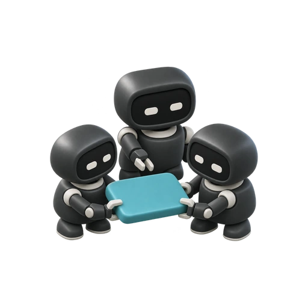

# Brief assets : objets 3D des heros Pro et Créateur (perspective)

Brief autonome pour l'agent assets de Kenz. 15/11/2026, Claude (Mac, session site Kenz).

**Direction validée par Kenz :** reprendre directement le style des objets HYROX : formes trapues et arrondies, matières graphite mates, détails ivoire et accents Lagon. Pour l'objet IA, Kenz a choisi et validé **trois petits robots qui collaborent** autour d'une tâche commune, avec un coordinateur et deux assistants, puis autorisé la production des six objets restants. Ce groupe remplace la sphère et le module de calcul. Il constitue une exception aux interdictions de robots et de visages ci-dessous : seuls leurs visages mécaniques simples sont autorisés, sans texte. Le nom `pro-noyau-ia` reste utilisé pour les fichiers déjà référencés par la maquette.

**Livraison complète :** les huit objets sont dans `assets/hero3d/`, en WebP transparent 1024 px sans perte et 512 px optimisé, avec PNG équivalents et prompts exacts à côté de chaque résolution. Génération avec l'outil intégré image_gen. Les huit copies WebP 512 px pèsent environ 182 ko au total. [Aperçu interactif avec néon réglable](assets/hero3d/index.html) · [Manifeste](assets/hero3d/manifest.json) · [Vérification des exports](assets/hero3d/validation.json). Planches à 400 et 80 px sur les fonds originaux : [Pro](assets/hero3d/planches/pro-400-80.webp), [Créateur](assets/hero3d/planches/createur-400-80.webp).

**Néon demandé après validation :** la lueur est ajoutée en HTML/CSS, sur les accents Lagon. Elle n'est pas peinte dans les images. Une démo autonome et le composant à reprendre sont livrés ; le composant de profondeur de la maquette n'a pas été modifié pour intégrer cet effet.

## Contexte
Les heros des deux univers du site de Kenz manquent de profondeur.
- On ajoute **des objets 3D qui flottent sur trois plans** autour du portrait de Kenz : loin et flou, milieu et net, près et grand. Ils bougent en parallaxe avec la souris et le défilement.
- Chaque série doit faire comprendre l'univers **sans texte**.

Maquette : https://claude.ai/artifact/MNrw9bbab3ZHZd1GyNrwCa (les heros de « Pro » et de « Créateur »).

Les fonds des heros, à ouvrir avant de générer, servent à accorder la lumière :
- Pro : `~/Documents/Dev/Kenz/kenz/output/hero-horizon-valide/01-horizon-pro.png`, heure bleue, collines dans la brume, montagnes enneigées ;
- Créateur : `~/Documents/Dev/Kenz/kenz/output/hero-horizon-valide/02-horizon-createur.png`, baie tropicale au coucher du soleil.

Pour le style d'objet, la référence est la série sport déjà validée : `~/Documents/Dev/Kenz/kenz/maquettes/v6/assets/sport3d/` (planche `planches/sombre-160.webp`). C'est le même niveau de finition « objet miniature de collection », mais avec la palette et la lumière de chaque hero.

## Règles communes
- **Un seul objet par image**, objet 3D miniature « collectionnable ».
  - Formes pleines, légèrement arrondies, finition premium et tactile.
  - Ni photoréaliste brut, ni cartoon.
- **Angle** : trois-quarts légèrement plongeant, le même dans chaque série. Chaque objet peut être un peu incliné, comme s'il flottait.
- **Fond réellement transparent** (canal alpha). Pas de sol, de socle, d'ombre portée détachée ni de halo peint. Le flou de profondeur et les ombres seront faits en CSS.
- **Aucun texte, chiffre, logo, marque, visage, personne ni main.**
- Master carré de 1024 px ou plus, plus une copie de 512 px, avec à côté le prompt exact dans un `.txt` du même nom.

## Série PRO : « je construis des apps où l'IA fait le vrai travail », dans l'heure bleue
**Palette** :
- verre clair, métal anodisé graphite et bleu nuit ;
- reflets froids bleu Lagon (famille `#3FB0C2`) ;
- **un seul élément chaud** possible, l'or du trophée.

**Lumière** : clair de lune froid venant d'en haut à gauche, liseré cyan doux sur le bord droit, comme sous le ciel de l'heure bleue.

**Pas de clichés de développeur** : pas de code, pas d'écran d'ordinateur, pas de fusée, pas d'engrenage, pas de cerveau, pas de robot.

| Fichier | Sujet |
|---|---|
| `pro-telephone.png` | un smartphone graphite arrondi, flottant incliné, avec un écran en dégradé Lagon vers le bleu nuit, **sans aucune interface, icône ni texte**. |
| `pro-noyau-ia.png` | un trio compact de petits robots graphite et ivoire collaborant autour d'une pièce Lagon commune, avec un coordinateur au centre ; finition miniature mate identique aux objets HYROX, aucun texte. |
| `pro-trophee.png` | une petite coupe-trophée en or brossé, élégante et sobre, sur un pied court en métal graphite. Sans plaque ni gravure. |
| `pro-satellite.png` | un petit satellite : corps compact graphite, deux panneaux bleu nuit, une antenne courte et un anneau Lagon dont la lueur est ajoutée en CSS. |

## Série CRÉATEUR : « je voyage en Asie, je m'entraîne entre deux voyages », au coucher du soleil
**Palette** :
- cuir, papier, laiton et toile ;
- tons chauds (cognac, crème, laiton doré), quelques touches Lagon (`#0F5D6B`) ;
- **aucun vert vif**, réservé à l'objet sport déjà livré.

**Lumière** : contre-jour doré de coucher de soleil venant de la droite, avec un liseré chaud orangé, et une lumière d'ambiance douce et chaude.

| Fichier | Sujet |
|---|---|
| `createur-passeport.png` | un passeport entrouvert à couverture graphite mate et arrondie, globe ivoire en relief, pages ivoire et petit accent Lagon au dos. **Sans texte, armoiries ni tampons**. |
| `createur-avion.png` | un avion de ligne miniature graphite et ivoire, dérive Lagon, vu de trois-quarts en légère montée. Pas de compagnie, logo ou immatriculation. |
| `createur-appareil.png` | un appareil photo compact graphite, anneau Lagon autour de l'objectif et courte dragonne en cuir cognac. Sans marque ni inscription. |
| `createur-etiquette.png` | une étiquette de bagage en cuir cognac, avec sangle, boucle en laiton et passant Lagon. Panneau ivoire **sans texte**. |

## Ordre conseillé
D'abord `pro-noyau-ia` et `createur-passeport`, à faire valider par Kenz, puis le reste de chaque série avec le même bloc de style.

## Prompt (bloc commun + série + sujet)
```
Use case: stylized-concept, premium floating 3D object for a personal website hero (depth layers around a portrait). One transparent PNG. Must match a validated series of premium miniature collectible 3D objects (same finish quality), with series-specific palette and lighting below.

Create ONE isolated miniature object, floating, slightly tilted: {SUBJECT}.

Style: premium tactile 3D product illustration, sophisticated miniature collectible design, slightly chunky refined proportions, strong clean silhouette, subtle surface detail. {SERIES_STYLE}

Composition: square 1024 x 1024 or higher PNG. Center the complete object at about 68% of the canvas, clear transparent margin on every side, no cropping. Must read clearly at 80 px and look premium at 400 px.

Background: GENUINELY TRANSPARENT ALPHA, clean antialiased edges. No floor, no pedestal, no detached drop shadow, no glow or halo painted outside the object, no checkerboard painted into the image.

Avoid: text, letters, numbers, logos, brand marks, airline liveries, flags, coats of arms, UI, app icons, code, computer screens, people, faces, hands, cartoon style, toy-like plastic, background scenery, multiple objects.
```

`{SERIES_STYLE}` PRO :
```
Materials: clear glass, dark graphite and night-blue anodized metal, cool Lagon-blue reflections (#3FB0C2 family); the only warm element allowed is brushed gold on the trophy. Lighting: cool moonlight from upper left, soft cyan rim light on the right edge, blue-hour mood, gentle internal glow where relevant.
```

`{SERIES_STYLE}` CRÉATEUR :
```
Materials: worn leather, paper, brass and canvas; warm cognac, cream and brass tones with small deep-Lagon (#0F5D6B) touches; no vivid green. Lighting: warm golden sunset backlight from the right with an orange rim light, soft warm ambient fill, golden-hour mood.
```

## Dépôt
- `~/Documents/Dev/Kenz/kenz/maquettes/v6/assets/hero3d/pro/`
- `~/Documents/Dev/Kenz/kenz/maquettes/v6/assets/hero3d/createur/`

Les copies de 512 px vont dans un sous-dossier `512/`. La maquette affichera les objets d'elle-même dès qu'ils seront déposés.

## Contrôle avant livraison
- Chaque série posée en planche sur son fond de hero, à 80 px et à 400 px : même angle, même lumière.
- Le canal alpha est propre.
- Aucun texte, logo ni interface, même minuscule.

## Intégration du néon pour l'agent de la maquette

Reprendre [neon.css](assets/hero3d/neon.css) et insérer le contenu de [neon-filter.svg](assets/hero3d/neon-filter.svg) **une seule fois en SVG inline** dans le document. Le filtre sélectionne les zones bleues Lagon, conserve le canal alpha et produit une lueur sur une copie superposée de l'image. Graphite, ivoire, cognac et or restent inchangés. La page [index.html](assets/hero3d/index.html) montre le montage complet avec réglage d'intensité et pulsation facultative.

À placer à l'intérieur de `.kz-prof__c`, pour conserver le flou et la parallaxe déjà gérés par ses parents :

```html
<span class="hero3d-neon" style="--neon-strength:.4">
  
  
</span>
```

- `--neon-strength` : `0` désactive la lueur ; `.25` à `.4` donne un accent discret.
- Ajouter `.hero3d-neon--pulse` au conteneur pour une pulsation douce. Le CSS respecte `prefers-reduced-motion`.
- `.kz-prof__c` possède déjà un halo général via `--halo-o`. Ajuster sa force si nécessaire sans remplacer ses filtres de profondeur par le filtre sélectif ; celui-ci appartient uniquement à la copie `.hero3d-neon__glow`.
- Démo vérifiée dans Chrome : huit objets chargés, effet visible à l'activation, absence d'erreur JavaScript et de débordement horizontal à 390 px, mouvement réduit respecté.
